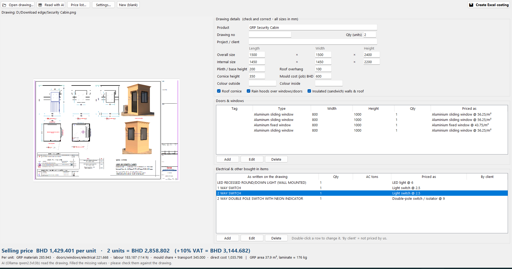

# Drawing to Estimate - GFPF Fiberglass Costing

Browser app that turns a customer description or drawing into a clear,
reviewable GRP material and cost estimate.

- Muse (Meta Model API) interprets descriptions and drawings, asks
  clarification questions and narrates results.
- Deterministic code does all geometry, quantities and money.
- Without an API key the app still runs end to end in manual mode.

Workflow: **Upload or Describe -> Review Inputs -> Calculate -> Compare & Save**



## Quick start (local)

```powershell
cd <path-to>\grp_costing_app
<your-python> -m venv .venv
.venv\Scripts\activate
pip install -r requirements.txt
uvicorn app.main:app --host 127.0.0.1 --port 8000
```

Open `http://127.0.0.1:8000` in a browser.

(Tested here with Python 3.14 and `python:3.12-slim` for Docker.)

## Environment variables

| Variable | Default | Purpose |
|---|---|---|
| `MODEL_API_KEY` | (empty) | Meta Model API key. Empty = manual mode, AI off. |
| `MODEL_ID` | `muse-wonder-1.0` | Model name, configurable. |
| `MODEL_API_BASE` | `https://api.meta.ai/v1` | API base URL. |
| `MODEL_API_FORMAT` | `responses` | `responses` or `chat`. |
| `MODEL_REASONING_EFFORT` | `low` | Reasoning effort for extraction. |
| `MODEL_TIMEOUT_S` | `90` | API timeout per call. |
| `MODEL_MAX_IMAGE_MB` | `8` | Largest drawing sent to the model. |
| `GFPF_DATA_PATH` | `data/estimates.json` | Saved-estimates file location. |
| `GFPF_RATES_PATH` | `data/rates.json` | Saved material-prices file location. |

PowerShell (current session only):

```powershell
$env:MODEL_API_KEY = "your-key-here"
```

Keys stay on the server: they are never sent to the browser, stored in
estimates, written to logs, or committed. There is no `.env` file support on
purpose for the local run - set the variable in your shell. For Docker,
`docker-compose.yml` passes `MODEL_API_KEY`/`MODEL_ID` through from the shell.

## Run with Docker

```powershell
docker compose up -d --build
```

Open `http://SERVER-IP:8000`. Set `MODEL_API_KEY` in the shell first if you
want AI extraction inside the container.

## Tests

```powershell
.venv\Scripts\python -m unittest discover -s tests
```

228 checks: geometry, costing regression, laminate schedules, labour
estimating, extras and pricing, bought-in schedule, PDF and Excel export,
units, store revisions, material prices, product-name detection, review and
rates page rendering, and the Muse client (mocked - no network).
See `HACKATHON.md` for live validation results.

## Calculation assumptions

- Laminate density 1,500 kg/m3 (editable), MEKP 1.5% of resin + gelcoat
  after wastage, default resin/fibre 70/30, default wastage 10%, overhead
  on subtotal. ISO skin-coat share 15%, consumables 5% of GRP materials,
  surface tissue behind outside gelcoat, bonding paste per piece.
- Panel flange = all-round planar border; cylinder ends optional discs;
  reducer = open concentric cone; box = tank/enclosure; custom = measured
  area for boat hulls and free-form parts.
- Standard ply schedules (CSM 300/450/600, WR600/800, gelcoat 0.55-0.65
  kg/m2) with a target-thickness cross-check; GP/ISO/VE resin choice,
  pigment, machine time, hardware, amortised new-mould cost and plywood/steel
  supports optional per estimate. See `PROCESS.md` for the research basis.
- Rates shipped are DEMO values. Replace with verified factory rates.

Every estimate lists its exclusions (tooling, delivery, testing, margin and
selling price, taxes). Estimates are material/cost guidance only - not
structural, pressure or certification ratings.

## Material prices

Open **Material prices** (`/rates`) to replace the demo rates with verified
factory prices. Updates are saved on the server and become the defaults for
new estimates; saved estimates keep their own snapshots and never change.
**Check online prices** fetches AI-suggested market rates into a New-rate
column - press **Update** on the rows you accept, then **Save prices**.
The request pins every row to its rate-book key via a JSON-schema enum so
weaker hosted models cannot return empty or invented keys; if the reply is
still unusable, the error quotes the first 200 characters of what the model
returned so the failure can be diagnosed from the UI alone.

## Drawings

JPG and PNG fully supported. PDF is accepted and its first page is rendered
for review (requires `pymupdf`, included in requirements).

## Layout

- `app/main.py` - routes and upload handling
- `app/shapes.py`, `app/costing.py`, `app/units.py`, `app/layup.py` -
  deterministic engine (geometry, money, units, ply schedules)
- `app/muse_client.py` - server-side Meta Model API client
- `app/store.py` - JSON revision store; `app/materials.py` - material prices
- `app/pdf_report.py` - estimation sheet PDF export
- `app/xlsx_report.py` - live-formula Excel workbook export
- `app/schedule.py` - bought-in item + opening detection from drawings
- `app/demo/` - fictional demo cases
- `tests/` - unit suite; `data/`, `uploads/` - runtime files (created on run)